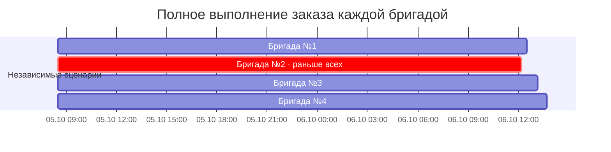
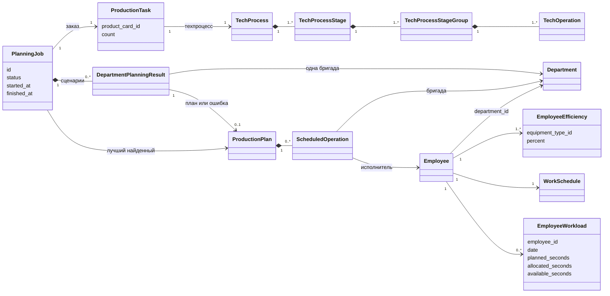
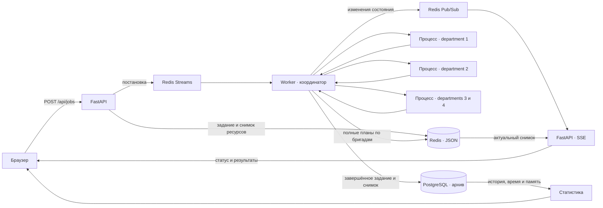

# Производственный планировщик

**Какой бригаде поручить заказ, чтобы завершить его раньше?**

Планировщик рассчитывает один и тот же заказ отдельно для каждого подразделения
(`Department`) и сравнивает полные планы на общей диаграмме Ганта. В каждом
сценарии работают только сотрудники своей бригады — с их квалификацией,
эффективностью и рабочими сменами.

Python 3.12 · OR-Tools CP-SAT · FastAPI · Redis Streams · SSE · PostgreSQL

## Попробовать

Нужны Docker и Docker Compose v2.

```bash
docker compose up --build web
```

Откройте **[планировщик](http://localhost:8096)**. Документация API —
[Swagger UI](http://localhost:8096/docs).
История, время расчёта и память — [статистика](http://localhost:8096/statistics).

1. Укажите количество изделий, дату начала и горизонт планирования.
2. Нажмите **«Сравнить бригады»**. Результаты появятся по мере расчёта.
3. Сравните даты завершения, операции на Ганте и эффективность сотрудников.

Compose запускает веб-сервис, Redis, PostgreSQL и worker. Демо содержит четыре бригады
по десять сотрудников и техпроцесс из шести этапов.

## Результат: один заказ — четыре сценария

Пример сохранённого расчёта: **изделие №1001, 1 штука, 47 операций**.
Общая точка начала — **5 октября 2026, 08:30**, горизонт — 14 календарных дней.

| Бригада | Операций | Время работы¹ | Заказ завершён |
| --- | ---: | ---: | --- |
| №1 | 47 | 11 ч 58 мин 25 сек | 6 октября, 12:30:57 |
| **№2** | **47** | **11 ч 39 мин 11 сек** | **6 октября, 12:11:12 — раньше всех** |
| №3 | 47 | 12 ч 39 мин 22 сек | 6 октября, 13:10:04 |
| №4 | 47 | 13 ч 10 мин 46 сек | 6 октября, 13:43:01 |



¹ Сумма длительностей операций без ожидания и перерывов. Полосы выше показывают
интервал от первой операции до окончания заказа, **включая ночной перерыв**.
В веб-интерфейсе каждая операция показана отдельным блоком.

[Исходные данные примера](docs/examples/department-comparison.json).
Все четыре плана имеют статус `FEASIBLE`: они допустимы, но оптимальность
не доказана. Этот пример сохранён до добавления случайной загрузки сотрудников.
При повторном расчёте назначения и время завершения могут отличаться.

В интерфейсе также доступны:

- **Текущая загрузка на Ганте** — серые полосы со штриховкой под планом бригады;
  показывают занятую долю смены каждого сотрудника без привязки ко времени суток.
- **Состав каждой бригады** — сотрудники, эффективность по оборудованию и доступное время на дату.
- **Дерево техпроцесса** — этап → группа → операция, оборудование и норма времени.
- **Статистика** — история из PostgreSQL, время расчёта, пик/прирост суммарного RSS worker и дочерних процессов,
  срок выбранного плана и открытие сохранённого результата.
- **Ход расчёта** — очередь, выполнение, промежуточные результаты и ошибки через SSE.

## Доменная модель · DDD

`PlanningJob` — агрегат одного запуска. Он хранит заказ, жизненный цикл,
результаты расчётов по бригадам и лучший найденный план. Входные ресурсы
сохраняются отдельно как неизменяемый снимок `PlanningRequest`.



Правила планирования:

- В сценарии одного department **весь заказ выполняет только эта бригада**.
- Бригада выполняет не более одной операции одновременно.
- Этапы выполняются последовательно, операции группы — по порядку.
- Исполнитель должен иметь квалификацию для нужного оборудования.
- Длительность: `ceil(norm_sec × 100 / efficiency_percent)`.
- Сумма новых операций сотрудника за день не превышает его `availableSeconds`.
  Тестовые данные задают уже занятую часть смены случайно от 0 до 3 часов.
- Операция целиком помещается в смену; следующие операции могут переноситься
  на последующие рабочие дни. Ночи и выходные исключаются.

## От запроса до результата

Worker запускает расчёты departments в пуле отдельных процессов — по умолчанию
четыре одновременно. Лимит задаётся переменной `DEPARTMENT_PROCESSES`.
Интерфейс показывает эти независимые сценарии параллельно на общей шкале —
словно бригады начали выполнение одного заказа от общей даты.



Ошибка одной бригады не отменяет остальные сценарии. Итогом становится план
с самой ранней датой завершения среди найденных. Redis обслуживает очередь и SSE; завершённые задания, исходные данные и полные
результаты сохраняются в PostgreSQL до подтверждения очереди. В Compose
используются отдельные именованные тома для Redis и PostgreSQL.

## Разработка и документация

```bash
# Доменные и интеграционные тесты, включая настоящий Redis
docker compose --profile test run --build --rm tests
```

| Что нужно | Где смотреть |
| --- | --- |
| Правила расчёта и сравнения | [Планирование](docs/planner/readme.md) |
| Задания, API, SSE и восстановление очереди | [Жизненный цикл задания](docs/tasks/task.md) |
| Локальный запуск, прокси, тесты и команды Docker | [Руководство разработчика](docs/development.md) |
| Сотрудники и эффективность | [Модель сотрудников](docs/employee/employee.md) |
| Операции и техпроцесс | [Модель техпроцесса](docs/operations/operations.md) |

Код разделён на `domain` (модель и правила), `application` (сценарии и порты),
`infrastructure` (CP-SAT и Redis). Точки входа: `planner.web`, `planner.worker`
и консольный `planner.main`.

Ограничения демо: до 30 изделий, горизонт до 60 календарных дней; операция
не разрывается между сменами. Разные задания — независимые расчёты, общего
календаря бронирования бригад между ними пока нет.
